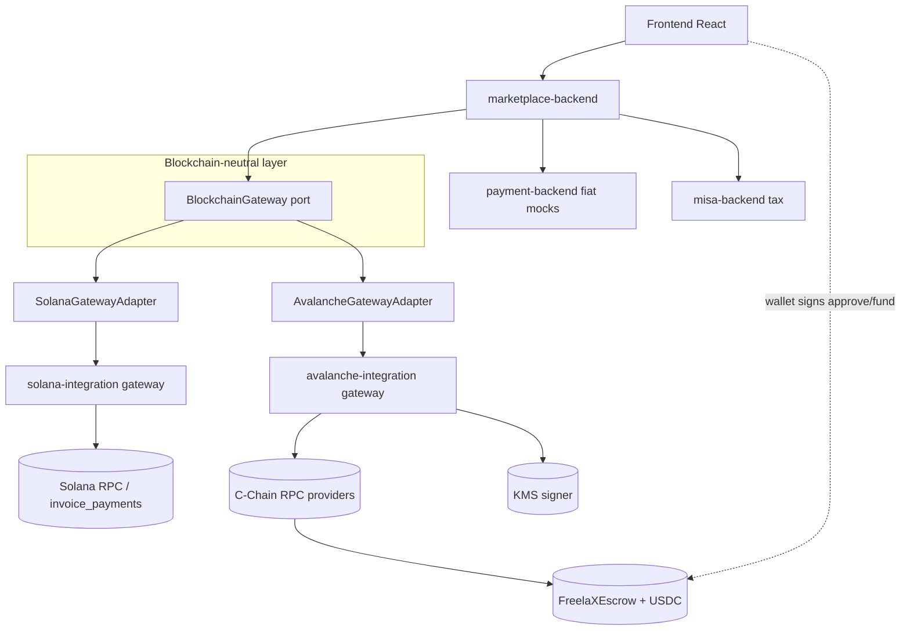
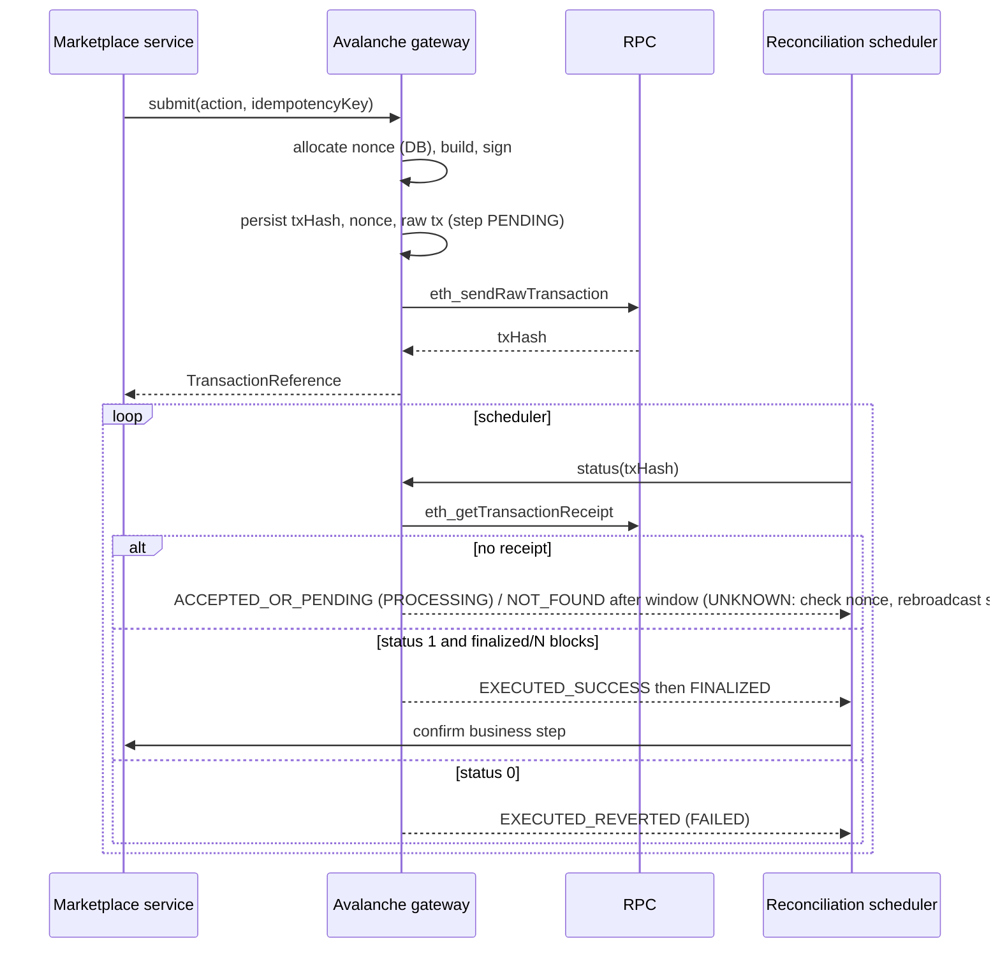
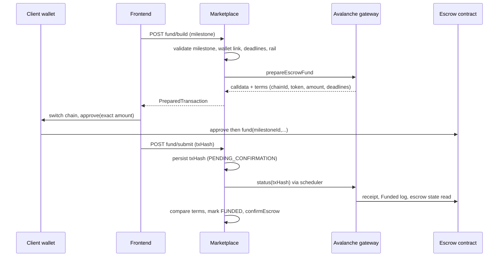
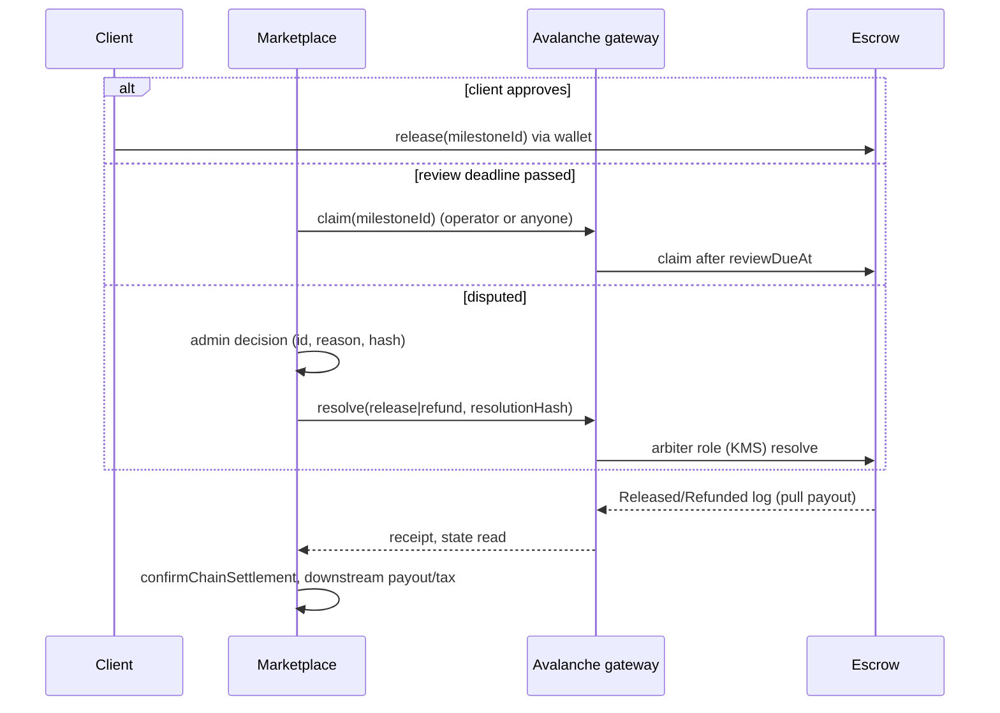
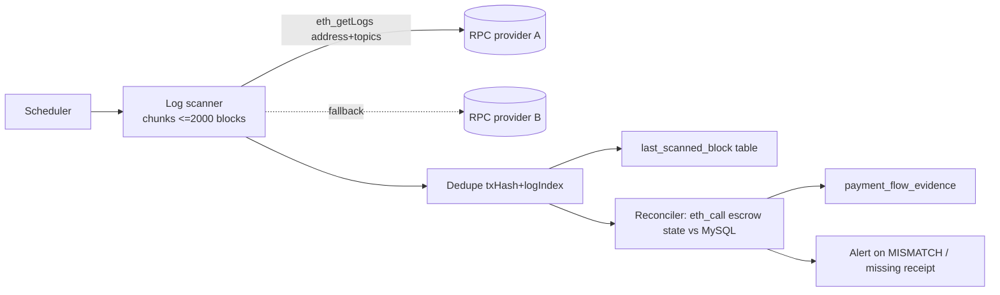
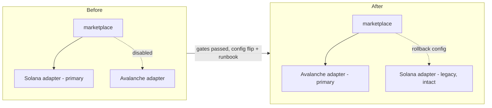

# 03. Target architecture

Principles: do not rewrite FreelaX; Solana stays; Avalanche is independently buildable; neutral types in the application layer; no unnecessary abstractions. Background: [00](00-current-architecture-audit.md), [01](01-avalanche-technical-research.md).

## 1. Layers and dependency direction
1. Marketplace business logic (jobs, contracts, disputes, fees, tax).
2. Payment application services (`PaymentFlowService`, `Unified*`, settlement).
3. Blockchain-neutral interfaces (`marketplace-backend/.../blockchain/`, `BlockchainGateway` and neutral records).
4. Chain infrastructure: Solana (`SolanaGatewayAdapter` -> `SolanaCprClient` -> `solana-integration`), Avalanche (`AvalancheGatewayAdapter` -> `avalanche-integration` gateway).
5. External integrations (`payment-backend`, `misa-backend`), independent of chain.
Dependencies point downward only: layers 1-2 depend on layer 3; adapters implement layer 3; adapters never reference each other. The Avalanche module has no dependency on any Solana module (and vice versa); the modules are separate Maven modules communicating over HTTP like the current gateway.

## 2. Gateway evaluation and recommended changes
Current `BlockchainGateway` (3 methods) is too small to host escrow; it grows only when a consumer moves (ADR rule). Candidate neutral operations, in the order consumers move:
- `network()`, `config()` (exists).
- `validateAddress(BlockchainAddress)`, `assetBalance(address, asset)`.
- `prepareEscrowFund(...)` returning a neutral `PreparedTransaction` (see below), `escrowState(EscrowReference)`.
- `submitEscrowAction(...)`, `transactionStatus(TransactionReference)`.
- `settlementReference`, `findWithdrawal` (only if the off-ramp concept survives).
Do **not** add event-indexing or generic "send tx" methods until a consumer needs them. New neutral types are added with first use: `TransactionReference` (id string + chain), `TransactionStatus` (SUBMITTED, ACCEPTED, EXECUTED_SUCCESS, EXECUTED_REVERTED, FINALIZED, NOT_FOUND) mapped by adapters; `PreparedTransaction` (opaque `chainFormat` + payload) so the frontend gets what its wallet needs (Solana: base64 partial tx; EVM: `{to, data, value, chainId}` calldata). Solana PDA, Borsh, Anchor types and web3j/ABI types must not appear in the port.
Normalise the Solana chain status strings into an `EscrowState.status` neutral enum inside the adapter, so `ContractDisputeService`, `ContractSubmissionService`, `PaymentFlowService` stop comparing `"Funded"`, `"Released"` literals.

## 3. Module boundaries
- `avalanche-integration` (new Maven module, Phase 2): Spring Boot REST gateway mirroring the Solana one: chain client, config validation, address/asset validation, signer (KMS interface), nonce allocator (own schema `avalanche_gateway`), tx submit/lookup, event decoding, error model. No FreelaX business imports.
- `avalanche-contracts/` (new folder, Phase 3): Foundry project (Solidity escrow, tests, scripts). Not a Maven module.
- `marketplace-backend/.../blockchain/avalanche/AvalancheGatewayAdapter` (Phase 4) implementing `BlockchainGateway`; an `AvalancheClient` (REST) in `client/`.
- Selection: a configuration property (for example `blockchain.primary=solana|avalanche`) chosen only at the final switch; both adapters can be active per `BlockchainNetwork` during Phase 4-6 for testing.

## 4. Diagrams

### Component diagram

### Transaction sequence (any backend-signed or user-signed EVM tx)

### Escrow funding sequence

### Escrow release sequence

### Event indexing and reconciliation

### Final primary-chain switch

## 5. Migration matrix
Columns: Current component | Responsibility | Solana dependency | Proposed Avalanche equivalent | Action | Risk | Validation.
| Current component | Responsibility | Solana dependency | Avalanche equivalent | Action | Risk | Validation |
|---|---|---|---|---|---|---|
| `BlockchainGateway` (`marketplace-backend/.../blockchain/`) | neutral port, 3 methods | none | extended port | extend per consumer | L | unit tests per method with both adapters |
| `SolanaGatewayAdapter` | Solana implementation of port | `SolanaCprClient` | `AvalancheGatewayAdapter` | keep, add sibling | L | adapter tests (like `SolanaGatewayAdapterTest`) |
| `SolanaCprClient` (`client/`) | REST client to gateway | gateway endpoints | `AvalancheClient` | keep; consumers move to port | M | contract tests against gateway stub |
| Solana RPC client (`solana-integration/.../SolanaRpcClient`) | JSON-RPC | Solana methods | web3j `Web3j` in new module | keep; add new | M | Fuji integration |
| Tx codec (`LegacyTransactionCodec`, `SolanaValueCodec`) | build/parse tx | Solana legacy tx | web3j raw tx + `FunctionEncoder` | keep; add new | M | golden-vector tests |
| Anchor/Borsh decoder (`AnchorAccountDecoder`, `BorshReader`) | decode accounts | Anchor | ABI decode of events and `eth_call` | keep; add new | M | decode tests from Fuji receipts |
| `LocalSignerRegistry` | dev keys | local RPC | KMS signer + dev-only local signer, same guards | add new | H | KMS signing test, low-s, recovery |
| Solana controllers (`SolanaGatewayController`) | REST | `/api/v1/solana` | `/api/v1/avalanche` | keep; add new | M | endpoint tests |
| `UnifiedUsdFundingService` | USD to USDC to escrow confirm | `SolanaOnRampProvider` (concrete) | port + test-USDC on-ramp strategy | finish moving onto port | M | existing tests + Fuji |
| `SolanaOnRampProvider` | mock USDC minting | `mock_onramp` ix | Fuji: Circle faucet/test token; no mock mint on real USDC | move behind port | M | idempotent receipt via mapping/log |
| `ClientPaymentServiceImpl` | publish rate, invoice, pay | Anchor invoice ixs | see below (legacy path) | keep Solana; decide per SQL evidence | H | SQL evidence first |
| `SolanaEscrow{Funding,Workflow,Timeout}Service` | escrow funding/actions/auto-claim/resolve | `SolanaCprClient`, status strings | neutral `EscrowState` + adapter | rename later, move behind port | H | existing + new EVM tests |
| Funding services (`FundingService`, `PartnerEscrowFundingService`) | fiat rails | none | none | no change | L | regression |
| Payout services (`Client/OnChainOffRamp/VndPayout/PayoutServiceImpl`, `SettlementDownstreamService`) | legacy payout | Anchor invoice/off-ramp | none initially | keep Solana legacy | H | SQL evidence |
| Reconciliation (`UnifiedReconciliationService`, `UnifiedFundingExpiryService`) | statement vs chain | `findEscrow`, receipts | port reads + log scan | move behind port | M | scheduled reconcile tests |
| Transaction recovery (UNKNOWN handling in services/schedulers) | re-query/retry | blockhash reasoning | nonce + tx hash reasoning | adapt | H | fault-injection tests |
| Event listeners | none exist | n/a | log scanner (new) | add | M | scanner recovery tests |
| Frontend wallet (`escrowWallet.ts`) | sign legacy tx | `@solana/web3.js`, Phantom | viem/wagmi EIP-1193 adapter | add behind neutral wallet interface | H | component + browser e2e on Fuji |
| USDC asset handling (`movePointRight(6)`, mint string) | amounts | 6 dec, mint | `(chainId,address)` config, decimals asserted | adapt | M | startup assertions, unit tests |
| Chain config (`solana-cpr.*`, `solana.*`) | config | Solana | `avalanche.*` | add new keys | L | config validation tests |
| DB chain references (`network`, `mint`, `escrow_address`, `*_signature`) | persistence | Solana-named | same columns reused, plus new columns (tx hash, chain id, nonce) | forward-only | M | migration tests on a copy |
| Payment rails | see [00](00-current-architecture-audit.md) | | | `SOLANA_ESCROW`/`UNIFIED_USDC_PAYOUT` need chain support; others none | M | rail regression matrix |
| Env/Docker (`docker-compose.yml`, `.env.example`) | config | `SOLANA_*`, `VITE_SOLANA_CLUSTER` | `AVALANCHE_*`, `VITE_CHAIN_*` | add; neutralise at final switch | L | compose smoke |
| Tests | coverage | Solana mocks | EVM equivalents | add | M | CI |

Rails note: a new rail value (for example `AVALANCHE_ESCROW`) is **not** proposed by default; whether an additional persisted rail literal or reuse of `UNIFIED_USDC_PAYOUT` with a chain column is cleaner is open ([07](07-open-questions.md)).

## 6. Escrow contract design (conceptual, no code)
Shared immutable `FreelaXEscrow` keyed by `milestoneId` (bytes16 or bytes32 from the existing UUID). Struct mirrors `MilestoneEscrow`: client, freelancer, arbiter, token (must equal configured token), amount, deadlines, extension flag, review window, review due, revisions used/max, submission/dispute/resolution hashes, status. Operations mirror Anchor instructions (fund, request/approve extension, submit, request revision, open dispute, release/claim, resolve, mutual refund via two-sided approval). Roles via `AccessControl` (DEFAULT_ADMIN multisig, ARBITER, OPERATOR); pausable; pull payouts; events for every transition. The backend-authority co-signature on fund/submit/revision is replaced by either an operator-only function or an EIP-712 backend authorization verified in-contract (decision pending, [07](07-open-questions.md)). Amounts stay full-amount in/out (fee remains off-chain as today).
