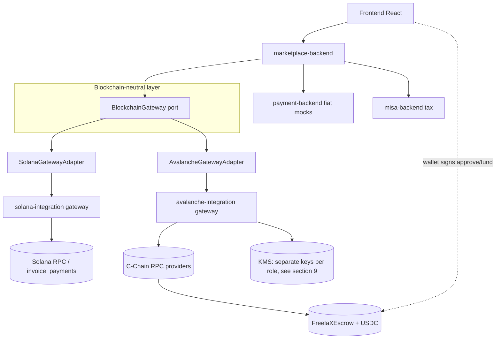
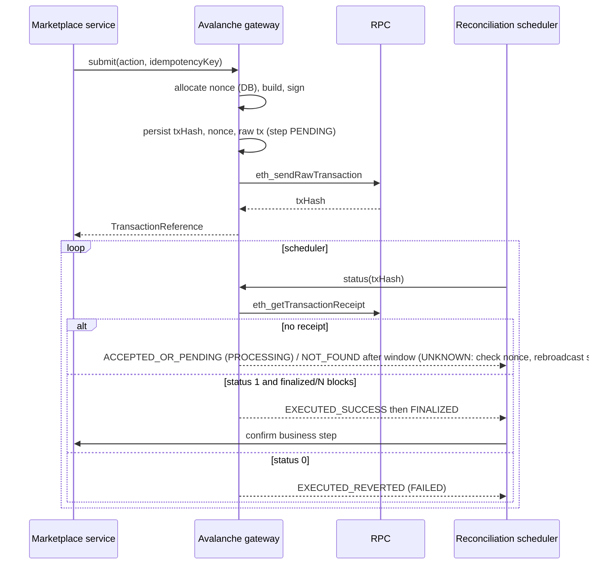
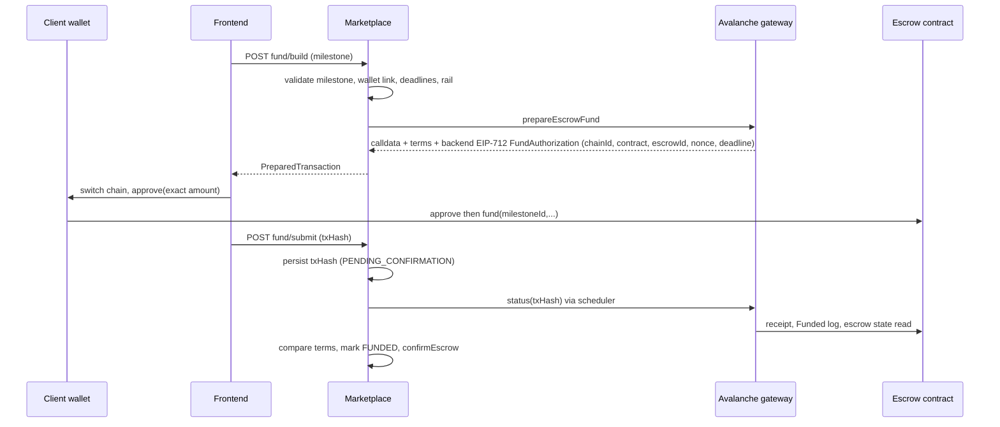
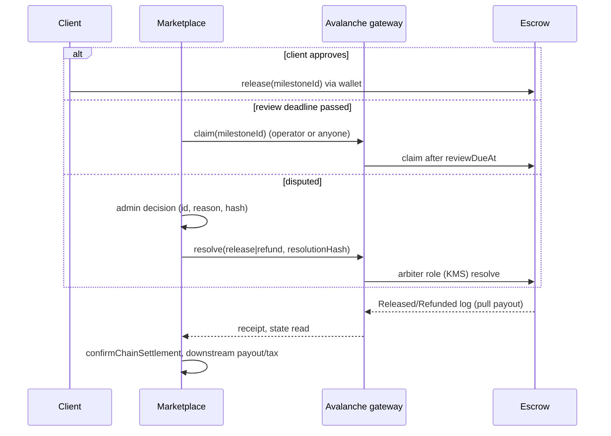
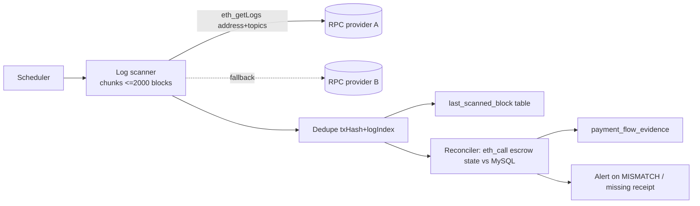
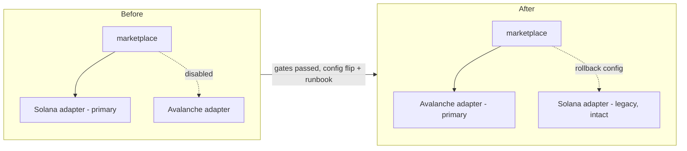
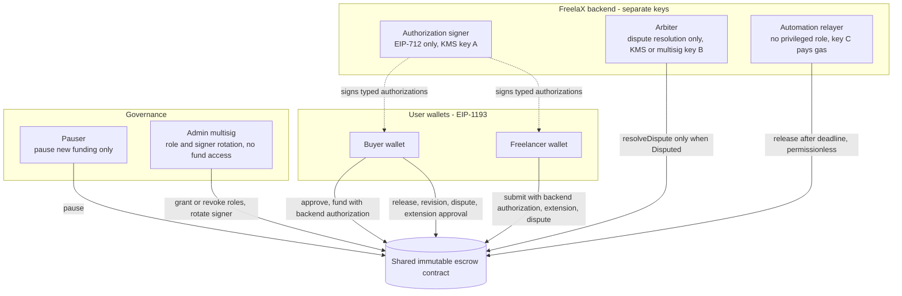

# 03. Target architecture

Principles: do not rewrite FreelaX; Solana stays; Avalanche is independently buildable; neutral types in the application layer; no unnecessary abstractions. Background: [00](00-current-architecture-audit.md), [01](01-avalanche-technical-research.md).

## 1. Layers and dependency direction
1. Marketplace business logic (jobs, contracts, disputes, fees, tax).
2. Payment application services (`PaymentFlowService`, `Unified*`, settlement).
3. Blockchain-neutral interfaces (`marketplace-backend/.../blockchain/`, `BlockchainGateway` and neutral records).
4. Chain infrastructure: Solana (`SolanaGatewayAdapter` -> `SolanaCprClient` -> `solana-integration`), Avalanche (`AvalancheGatewayAdapter` -> `avalanche-integration` gateway).
5. External integrations (`payment-backend`, `misa-backend`), independent of chain.
Dependencies point downward only: layers 1-2 depend on layer 3; adapters implement layer 3; adapters never reference each other. The Avalanche module has no dependency on any Solana module (and vice versa); the modules are separate Maven modules communicating over HTTP like the current gateway.

## 2. Gateway evaluation and recommended changes
Current `BlockchainGateway` (3 methods) is too small to host escrow; it grows only when a consumer moves (ADR rule). Candidate neutral operations, in the order consumers move:
- `network()`, `config()` (exists).
- `validateAddress(BlockchainAddress)`, `assetBalance(address, asset)`.
- `prepareEscrowFund(...)` returning a neutral `PreparedTransaction` (see below), `escrowState(EscrowReference)`.
- `submitEscrowAction(...)`, `transactionStatus(TransactionReference)`.
- `settlementReference`, `findWithdrawal` (only if the off-ramp concept survives).
Do **not** add event-indexing or generic "send tx" methods until a consumer needs them. New neutral types are added with first use: `TransactionReference` (id string + chain), `TransactionStatus` (SUBMITTED, ACCEPTED, EXECUTED_SUCCESS, EXECUTED_REVERTED, FINALIZED, NOT_FOUND) mapped by adapters; `PreparedTransaction` (opaque `chainFormat` + payload) so the frontend gets what its wallet needs (Solana: base64 partial tx; EVM: `{to, data, value, chainId}` calldata). Solana PDA, Borsh, Anchor types and web3j/ABI types must not appear in the port.
Normalise the Solana chain status strings into an `EscrowState.status` neutral enum inside the adapter, so `ContractDisputeService`, `ContractSubmissionService`, `PaymentFlowService` stop comparing `"Funded"`, `"Released"` literals.

## 3. Module boundaries
- `avalanche-integration` (new Maven module, Phase 2): Spring Boot REST gateway mirroring the Solana one: chain client, config validation, address/asset validation, signer (KMS interface), nonce allocator (own schema `avalanche_gateway`), tx submit/lookup, event decoding, error model. No FreelaX business imports.
- `avalanche-contracts/` (new folder, Phase 3): Foundry project (Solidity escrow, tests, scripts). Not a Maven module.
- `marketplace-backend/.../blockchain/avalanche/AvalancheGatewayAdapter` (Phase 4) implementing `BlockchainGateway`; an `AvalancheClient` (REST) in `client/`.
- Selection: a configuration property (for example `blockchain.primary=solana|avalanche`) chosen only at the final switch; both adapters can be active per `BlockchainNetwork` during Phase 4-6 for testing.

## 4. Diagrams

### Component diagram

### Transaction sequence (any backend-signed or user-signed EVM tx)

### Escrow funding sequence

### Escrow release sequence

### Event indexing and reconciliation

### Final primary-chain switch

## 5. Migration matrix
Columns: Current component | Responsibility | Solana dependency | Proposed Avalanche equivalent | Action | Risk | Validation.
| Current component | Responsibility | Solana dependency | Avalanche equivalent | Action | Risk | Validation |
|---|---|---|---|---|---|---|
| `BlockchainGateway` (`marketplace-backend/.../blockchain/`) | neutral port, 3 methods | none | extended port | extend per consumer | L | unit tests per method with both adapters |
| `SolanaGatewayAdapter` | Solana implementation of port | `SolanaCprClient` | `AvalancheGatewayAdapter` | keep, add sibling | L | adapter tests (like `SolanaGatewayAdapterTest`) |
| `SolanaCprClient` (`client/`) | REST client to gateway | gateway endpoints | `AvalancheClient` | keep; consumers move to port | M | contract tests against gateway stub |
| Solana RPC client (`solana-integration/.../SolanaRpcClient`) | JSON-RPC | Solana methods | web3j `Web3j` in new module | keep; add new | M | Fuji integration |
| Tx codec (`LegacyTransactionCodec`, `SolanaValueCodec`) | build/parse tx | Solana legacy tx | web3j raw tx + `FunctionEncoder` | keep; add new | M | golden-vector tests |
| Anchor/Borsh decoder (`AnchorAccountDecoder`, `BorshReader`) | decode accounts | Anchor | ABI decode of events and `eth_call` | keep; add new | M | decode tests from Fuji receipts |
| `LocalSignerRegistry` | dev keys | local RPC | KMS signer + dev-only local signer, same guards | add new | H | KMS signing test, low-s, recovery |
| Solana controllers (`SolanaGatewayController`) | REST | `/api/v1/solana` | `/api/v1/avalanche` | keep; add new | M | endpoint tests |
| `UnifiedUsdFundingService` | USD to USDC to escrow confirm | `SolanaOnRampProvider` (concrete) | port + test-USDC on-ramp strategy | finish moving onto port | M | existing tests + Fuji |
| `SolanaOnRampProvider` | mock USDC minting | `mock_onramp` ix | Fuji: Circle faucet/test token; no mock mint on real USDC | move behind port | M | idempotent receipt via mapping/log |
| `ClientPaymentServiceImpl` | publish rate, invoice, pay | Anchor invoice ixs | see below (legacy path) | keep Solana; decide per SQL evidence | H | SQL evidence first |
| `SolanaEscrow{Funding,Workflow,Timeout}Service` | escrow funding/actions/auto-claim/resolve | `SolanaCprClient`, status strings | neutral `EscrowState` + adapter | rename later, move behind port | H | existing + new EVM tests |
| Funding services (`FundingService`, `PartnerEscrowFundingService`) | fiat rails | none | none | no change | L | regression |
| Payout services (`Client/OnChainOffRamp/VndPayout/PayoutServiceImpl`, `SettlementDownstreamService`) | legacy payout | Anchor invoice/off-ramp | none initially | keep Solana legacy | H | SQL evidence |
| Reconciliation (`UnifiedReconciliationService`, `UnifiedFundingExpiryService`) | statement vs chain | `findEscrow`, receipts | port reads + log scan | move behind port | M | scheduled reconcile tests |
| Transaction recovery (UNKNOWN handling in services/schedulers) | re-query/retry | blockhash reasoning | nonce + tx hash reasoning | adapt | H | fault-injection tests |
| Event listeners | none exist | n/a | log scanner (new) | add | M | scanner recovery tests |
| Frontend wallet (`escrowWallet.ts`) | sign legacy tx | `@solana/web3.js`, Phantom | viem/wagmi EIP-1193 adapter | add behind neutral wallet interface | H | component + browser e2e on Fuji |
| USDC asset handling (`movePointRight(6)`, mint string) | amounts | 6 dec, mint | `(chainId,address)` config, decimals asserted | adapt | M | startup assertions, unit tests |
| Chain config (`solana-cpr.*`, `solana.*`) | config | Solana | `avalanche.*` | add new keys | L | config validation tests |
| DB chain references (`network`, `mint`, `escrow_address`, `*_signature`) | persistence | Solana-named | same columns reused, plus new columns (tx hash, chain id, nonce) | forward-only | M | migration tests on a copy |
| Payment rails | see [00](00-current-architecture-audit.md) | | | `SOLANA_ESCROW`/`UNIFIED_USDC_PAYOUT` need chain support; others none | M | rail regression matrix |
| Env/Docker (`docker-compose.yml`, `.env.example`) | config | `SOLANA_*`, `VITE_SOLANA_CLUSTER` | `AVALANCHE_*`, `VITE_CHAIN_*` | add; neutralise at final switch | L | compose smoke |
| Tests | coverage | Solana mocks | EVM equivalents | add | M | CI |

Rails note: a new rail value (for example `AVALANCHE_ESCROW`) is **not** proposed by default; whether an additional persisted rail literal or reuse of `UNIFIED_USDC_PAYOUT` with a chain column is cleaner is open ([07](07-open-questions.md)).

## 6. Escrow contract design (conceptual, no code)
Shared immutable `FreelaXEscrow` keyed by `milestoneId` (bytes16 or bytes32 from the existing UUID). Struct mirrors `MilestoneEscrow`: client, freelancer, arbiter, token (must equal configured token), amount, deadlines, extension flag, review window, review due, revisions used/max, submission/dispute/resolution hashes, status. Operations mirror Anchor instructions (fund, request/approve extension, submit, request revision, open dispute, release/claim, resolve, mutual refund via two-sided approval). Roles via `AccessControl` (ADMIN multisig, ARBITER, PAUSER, backend authorization signer; the relayer needs no role); pause blocks new funding only; payouts must tolerate a USDC blacklist (pull or claimable-balance design, open); events for every transition. The backend co-signature on fund/submit/revision is replaced by a constrained EIP-712 authorization (decision D3; full mapping in section 7, roles in section 9). The contract keeps the on-chain escrow rules (decision D4; section 7). Isolation and the factory gate are in section 10. Amounts stay full-amount in/out (fee remains off-chain as today).

---
# Revision 2 (decisions D1-D4)

## 7. Anchor-to-Solidity mapping (every escrow instruction)
Source of truth: `solana-stablecoin-payout/programs/invoice_payments/src/instructions/milestone_escrow.rs` and `state/escrow_state.rs`, read directly. Solidity names are descriptive placeholders, not code. `escrowId` = the existing milestone UUID (16 bytes) widened to `bytes32`; one escrow per milestone (the Anchor PDA `init` and the DB unique constraints make a duplicate impossible, so the contract must revert on an existing id).

Constants in the program: review window 24 to 168 hours (`MIN_REVIEW_HOURS`/`MAX_REVIEW_HOURS`), maximum extension 7 days, high-value threshold 500,000,000 base units (500 USDC) adding 24h only when the caller passes `high_value_review_grace`, `max_revisions <= 2`, USDC decimals 6. The 72h review window and `max_revisions = 2` are **values chosen by the backend and passed in**, not program constants.

| Anchor instruction | Required signers today | Preconditions and checks (verbatim semantics) | Transition | Proposed EVM function | EVM authorization |
|---|---|---|---|---|---|
| `fund_milestone_escrow` | client **and** marketplace authority (`config.admin`) | not paused; mint equals `config.accepted_mint` and decimals 6; `amount>0`; `funding_expires_at >= now`; `delivery_due_at > now`; review hours in 24..168; `max_revisions <= 2`; freelancer non-zero, `!= client`, `!= admin`; `client != admin`; +24h grace if flag set and amount > 500 USDC; token moved client to vault; arbiter := `config.admin` snapshot | none to Funded | `fund(terms, backendAuth)` | `msg.sender` = client; EIP-712 `FundAuthorization` from the backend authorization signer; ERC-20 `approve` precedes; token must equal the configured token; same range checks; arbiter must differ from client and freelancer; `whenNotPaused` |
| `request_escrow_extension` | freelancer | status Funded; `!extension_used` and none pending; `now < original_delivery_due_at`; `original < new <= original + 7d` | Funded (pending request recorded) | `requestExtension(id, newDue)` | `msg.sender` = freelancer; no backend |
| `approve_escrow_extension` | client | status Funded; `!extension_used`; `now < original_delivery_due_at`; a request exists | `delivery_due_at := requested`, `extension_used := true` | `approveExtension(id)` | `msg.sender` = client; no backend |
| `submit_escrow_work` | freelancer **and** arbiter co-sign | evidence hash non-zero; status Funded or Revision; if Funded then `now <= delivery_due_at`; sets `review_due_at = now + review_window_seconds`, `submission_count++` | Funded/Revision to Submitted | `submit(id, evidenceHash, backendAuth)` | `msg.sender` = freelancer; EIP-712 `SubmitAuthorization` (escrowId, evidenceHash, submissionCount, nonce, deadline) |
| `request_escrow_revision` | client **and** arbiter co-sign | feedback hash non-zero; status Submitted; `now < review_due_at`; `revisions_used < max_revisions`; clears `review_due_at` | Submitted to Revision | `requestRevision(id, feedbackHash, [backendAuth])` | `msg.sender` = client; backend authorization kept for parity, necessity open (see classification) |
| `open_escrow_dispute` | client or freelancer (no co-sign) | reason hash non-zero; status Submitted with `now < review_due_at`, or Funded with `now > delivery_due_at`, or Revision (no time check); records disputer and time, clears `review_due_at` | to Disputed | `openDispute(id, reasonHash)` | `msg.sender` is client or freelancer; no backend |
| `settle_milestone_escrow` (release, not disputed) | any signer; client at any time, anyone once `now >= review_due_at` | resolution hash must be zero; status Submitted; pays the full amount to the freelancer | Submitted to Released | `release(id)` (permissionless once eligible) | no role; eligibility computed in the contract: `msg.sender == client` or `block.timestamp >= reviewDueAt`; the relayer is a convenience only |
| `settle_milestone_escrow` (Disputed) | arbiter only | resolution hash non-zero; recipient = freelancer if release, client if refund; full amount | Disputed to Released or Refunded | `resolveDispute(id, release, resolutionHash)` | `ARBITER` role (or per-escrow arbiter, open); no other path |
| `settle_milestone_escrow` (refund, not disputed) | n/a | rejected with `InvalidEscrowState` | none | no function | none: **no unilateral refund exists and none may be added without approval** |
| `refund_mutual_escrow` | client **and** freelancer | status Funded, Submitted or Revision (not Disputed); full refund to client | to Refunded | `mutualRefund(id, deadline, clientSig, freelancerSig)` | EIP-712 `MutualRefund` signed by both (escrowId, nonce, deadline), anyone may submit; or two separate approvals (open) |
| `update_config` / `initialize_config` (escrow-relevant part) | `config.admin` | `paused` flag, accepted mint, roles | config | `pause()`, `unpause()`, role and authorization-signer management | `PAUSER` can only pause new funding; `ADMIN` multisig manages roles; token fixed at deployment |

Timing semantics to preserve exactly (they never overlap): submit `now <= delivery_due_at`; dispute from Funded `now > delivery_due_at`; revision and dispute from Submitted `now < review_due_at`; release by a non-client `now >= review_due_at`. At exactly `review_due_at`, release is allowed and dispute/revision are not. A valid dispute clears the review deadline and the Submitted-only release path, so auto-release cannot fire on a Disputed escrow. A dispute attempted after the deadline fails, and release is then permissionless.

Solana-only mechanics with no EVM equivalent: PDA/vault derivation (the shared contract keeps per-escrow `amount` in storage), ATA creation by the actor (`init_if_needed`, rent sponsorship), fee payer sponsorship, `recipient` account checks.

## 8. Transaction tracking record (EVM-specific)
Persisted per submitted transaction in the Avalanche gateway's own tables and referenced from existing ledger rows (no enum changes): `chainId`, `txHash`, `sender`, `nonce`, `rawTx`, `createdAt`, `submittedAt`, `submissionStatus`, `observedStatus` (`NOT_FOUND`, `SEEN_NO_RECEIPT` meaning accepted or pending but not executed, `EXECUTED_SUCCESS`, `EXECUTED_REVERTED`), `blockNumber`, `blockHash`, `receiptStatus`, `gasUsed`, `effectiveGasPrice`, matched log indexes, `replacedByTxHash`, `errorClass` (definitive vs non-definitive), `lastCheckedAt`, `finalizedAt`.
- **Accepted is not executed.** `SEEN_NO_RECEIPT` never counts as success. Only a receipt with status 1 and the expected contract/logs counts as executed; a reverted receipt is a definitive failure. Whether an accepted-but-unexecuted transaction is observable through `eth_getTransactionByHash` is **unverified** ([07](07-open-questions.md)), so the design relies only on receipt availability.
- **Replacement and nonce.** A nonce consumed by a different hash means this attempt is dead; re-broadcasting the same signed bytes is idempotent; a fee-bumped replacement keeps the nonce and records `replacedByTxHash`. Duplicate protection comes from persisting the hash before sending and from the contract rejecting a second `fund` or an invalid transition.
- **UNKNOWN is kept.** Non-definitive RPC errors, or no receipt after the window, map to the existing `UNKNOWN` step status and are re-queried by `txHash` and `eth_getTransactionCount`, never by blockhash expiry.
- **Reconciliation.** Log scan by `(txHash, logIndex)` plus an `eth_call` escrow state read compared with MySQL. Contract state wins for custody, status, deadlines and counters (D4); MySQL wins for business state.
- **Deadline race.** Under asynchronous execution a transaction submitted before a deadline can execute after it. Contract time checks use the execution block's timestamp, so late execution reverts safely, but the backend must re-read the escrow state before treating a boundary revert as a business failure. The exact semantics of `block.timestamp` after Helicon are unverified ([07](07-open-questions.md)).

## 9. Role-separated signing (D3)

| Role | May | May not | Key custody |
|---|---|---|---|
| Buyer wallet | approve, fund, release, request revision, approve extension, open dispute, mutual refund | act for others | user wallet |
| Freelancer wallet | request extension, submit, open dispute, mutual refund | release early | user wallet |
| Backend authorization signer | sign typed authorizations for `fund`, `submit`, `requestRevision` | submit fund-moving transactions, resolve disputes, pause, change roles; its only on-chain effect is that its signature is accepted for those three actions | KMS key (non-exportable), rotatable by admin |
| Arbiter | `resolveDispute` on Disputed escrows | release or refund non-disputed escrows; sign fund/submit authorizations | separate KMS key or multisig; rotatable |
| Automation relayer | call permissionless functions (`release` after the deadline), pay gas | anything privileged; the contract must not require it | operational hot key with minimal AVAX |
| Pauser | `pause` (new funding only) | unpause, move funds, block release or refund | separate key |
| Admin | grant/revoke roles, rotate the authorization signer, unpause | withdraw escrowed funds, override an escrow state | multisig, timelock as a design option |

EIP-712 domain: `name`, `version`, `chainId`, `verifyingContract`. Typed data binds `escrowId`, `action`, a per-escrow `nonce`, a `deadline` and the action parameters. For `fund`: client, freelancer, token, amount, `fundingExpiresAt`, `deliveryDueAt`, `reviewWindowHours`, `maxRevisions`, `highValueGrace`, arbiter. For `submit`: `evidenceHash`, `submissionCount`. For `requestRevision`: `feedbackHash`, `revisionsUsed`. Per-escrow nonces and short deadlines prevent replay across escrows, chains and time. The contract recovers the signer with `ECDSA` and compares it with the current authorization signer; rotation affects new authorizations only.

Key management requirements (design only, nothing is implemented in Phase 1):
- KMS/HSM keys per role; no key shared between roles; EIP-712 digests signed in KMS with DER-to-(r,s,v) conversion handled in the signer module.
- Rotation: admin adds the new signer, revokes the old one, outstanding authorizations expire by deadline.
- Emergency response: pause new funding, rotate signer or arbiter, stop the relayer; escrowed funds stay governed by contract rules.
- Recovery: the admin multisig replaces the arbiter and the signer. A lost arbiter key would strand Disputed escrows, so a role-based arbiter with admin rotation is preferred over a permanent per-escrow snapshot (the Solana program snapshots the arbiter at fund time; see [07](07-open-questions.md)).
- No plaintext keys, no keys in the frontend, startup guards forbidding dev signers on the Mainnet chain id.

### Classification of existing Solana signature requirements
| Requirement | Category | Rationale and action |
|---|---|---|
| Marketplace authority co-sign on `fund` | Real business authorization: terms integrity (only marketplace-recorded terms can be funded) | replace with EIP-712 `FundAuthorization` |
| Marketplace authority co-sign on `submit` | Real business authorization: a freelancer must not start the review clock, and with it auto-release, using evidence the marketplace never recorded | replace with EIP-712 `SubmitAuthorization` bound to the evidence hash |
| Marketplace authority co-sign on `request_revision` | Business authorization, candidate for elimination: only the client benefits and revisions are capped at 2 by the contract; the co-sign mainly binds the feedback record | keep for parity until a product decision (open question) |
| Arbiter as the only signer of Disputed settlement | Real business authorization | `ARBITER` role |
| Client or freelancer signing their own actions | Real authorization | `msg.sender` checks |
| Both parties signing mutual refund | Real authorization | two EIP-712 signatures or two approvals |
| Fee payer and rent sponsor signatures | Solana artifact, eliminated | gas is paid by the sender or a relayer |
| `config.admin` as arbiter, co-signer, claimer and resolver at once | Anti-pattern, not reproduced | separate roles |
| Backend scheduler as signer of auto-claim | Convenience, not authority | permissionless `release`; relayer optional |

## 10. Escrow isolation (D2)
- **Logical isolation (shared contract):** a per-`escrowId` record holds buyer, freelancer, amount, deadlines, counters, hashes, status and nonce. All escrows share one token balance at one address, so isolation is enforced by accounting and authorization, not by separate custody.
- **Physical (address) isolation:** a separate vault per escrow. Solana has this today: each escrow's vault is an ATA owned by that escrow's PDA. A shared EVM contract does not. A factory with EIP-1167 clones would restore address-level separation at the cost of a deployment per escrow and more addresses to monitor.
- **Concrete tradeoff for the Phase 3 gate:** USDC can blacklist or pause an address. With a shared contract, blacklisting the contract address would freeze all open escrows; with clones, only one. Counterpoints: clones can also be targeted individually, and the shared design is smaller to audit. No gas measurements were taken. The decided baseline is the shared immutable contract; the gate decides whether clones add enough benefit.
- **Required invariants** (to become Foundry invariant tests): the sum of open escrow amounts is at most the contract's token balance; no release or refund exceeds the escrow's deposited amount; a settled escrow cannot settle again; a signature cannot authorize another escrow, chain or contract; a dispute changes only its own escrow; terminal states are final; tokens sent directly to the contract cannot be claimed by any escrow.

## 11. Legacy rails and historical references (C)
First-release Avalanche scope: escrow funding, actions and release for `SOLANA_ESCROW`-style and `UNIFIED_USDC_PAYOUT` contracts. `PARTNER_ESCROW_MOCK` and the fiat funding of the legacy null rail have no chain code. The legacy downstream payout (invoice, off-ramp, tax) stays on Solana until read-only SQL evidence exists. Historical Solana references stay readable: existing `*_signature`, `escrow_address` and `network` columns are not modified; new rows carry an explicit chain/network value; explorer links, the MISA `blockchain` field and tax certificates must choose the chain per record instead of the hard-coded `"solana"` literal.
