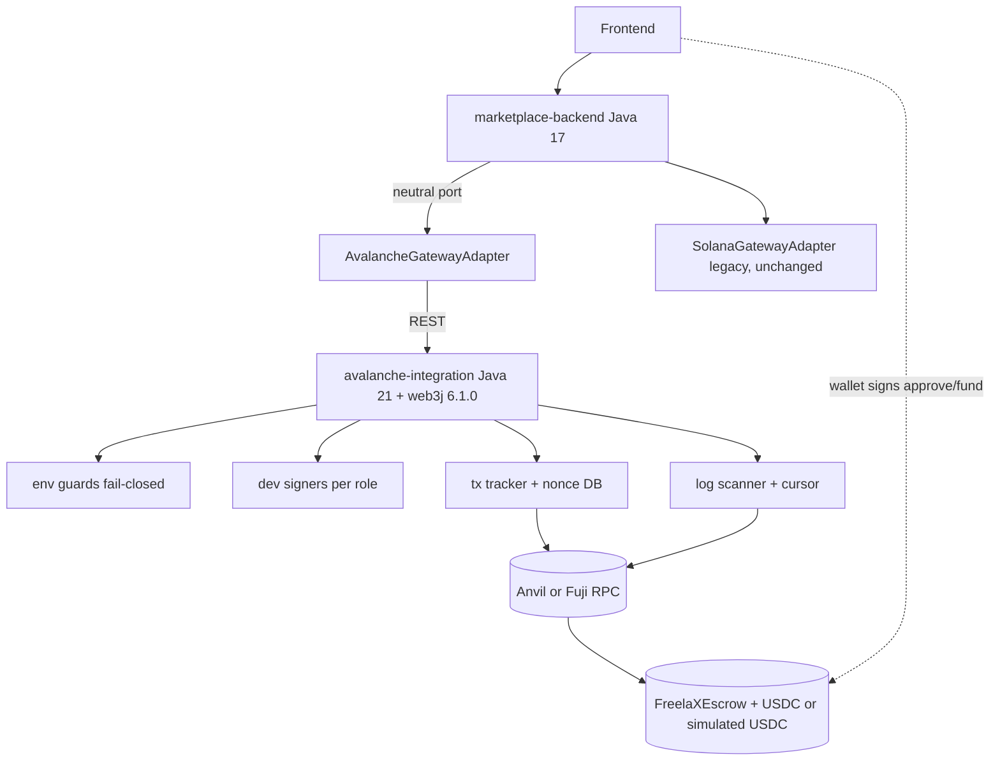

# 01. Target module architecture (plan)

Builds on [03 target architecture](../03-target-architecture.md). This document fixes boundaries and names for Phase 2; it does not add code. Existing conventions respected: Maven multi-module root (`payment-backend`, `marketplace-backend`, `misa-backend`, `solana-integration`), the neutral package `com.marketplace.backend.blockchain` (`BlockchainGateway`, `BlockchainNetwork`, `AssetReference`, `BlockchainAddress`, `EscrowReference`, `EscrowState`, `ChainConfig`, `solana/SolanaGatewayAdapter`), REST clients in `client/` (`SolanaCprClient`), property-driven `@Scheduled` reconciliation jobs, additive Flyway migrations.

## 1. The ten conceptual boundaries and where each lives
| # | Boundary | Lives in | Must not contain |
|---|---|---|---|
| 1 | Blockchain-neutral domain interfaces | `marketplace-backend/.../blockchain/` (extend the existing port only when a consumer moves) | web3j, ABI, Solana PDA/Borsh/Anchor types, chain-specific strings |
| 2 | Avalanche C-Chain adapter (web3j 6.1.0) | new Maven module `avalanche-integration` (client, signer, tracker) + `marketplace-backend/.../blockchain/avalanche/AvalancheGatewayAdapter` and `client/AvalancheClient` (REST only) | business rules of PaymentFlow |
| 3 | Solidity escrow contracts | new folder `avalanche-contracts/` (Foundry; not a Maven module) | backend logic, fees, tax |
| 4 | Contract deployment and configuration for Anvil and Fuji | `avalanche-contracts/script/` + a per-environment **deployment manifest** read by `avalanche-integration` | private keys, Mainnet entries |
| 5 | EVM transaction submission and receipt tracking | `avalanche-integration` (`tx` package) | Solana blockhash reasoning |
| 6 | Event indexing and reconciliation | `avalanche-integration` (`scan` package) driving existing `marketplace-backend` schedulers through the port | an external indexer (not justified by Phase 1) |
| 7 | EIP-712 authorization and signature verification | contract (verify) + `avalanche-integration` (`auth` package: typed-data builders, nonce/deadline policy) | policy decisions about *what* to authorize (those come from MySQL records in the marketplace) |
| 8 | Ephemeral development signing | `avalanche-integration` (`signer` package, `Signer` interface, dev implementation) | KMS, production keys, any key persisted silently |
| 9 | Simulation environment guards | `avalanche-integration` (`env` package, fail-closed startup) and mirrored validation in the marketplace configuration | chain ids outside the allow-list, Mainnet config |
| 10 | Frontend wallet and transaction integration | `frontend/src` behind a neutral wallet interface | Solana-specific assumptions in shared components |
EVM-specific concepts (nonce, gas, ABI, logs, EIP-712, chain id) stay inside boundaries 2 to 9. The Solana PDA/Anchor/Borsh/instruction architecture is **not** reproduced in Solidity: the contract keeps a per-`escrowId` record (see [02](02-contract-implementation-plan.md)).

## 2. Module decision: separate service, not a library (needs owner confirmation)
Phase 0 assumed a separate Spring Boot gateway mirroring `solana-integration`. Phase 1 evidence strengthens it:
- web3j 6.1.0 brings **Jackson 3** and needs `jackson-annotations` 2.22, while the root pom pins `jackson-bom.version` 2.21.7. A separate service keeps this arrangement **out of `marketplace-backend`** and `misa-backend`/`payment-backend`.
- Owner decision: Java 21 for the Avalanche integration. Web3j 6.1.0 bytecode is Java 21 (class version 65) and cannot load on Java 17. The marketplace stays at Java 17 and talks to the gateway over HTTP, as it does with Solana.
- Signer isolation: development keys live in the gateway process, not in the marketplace.
- Own schema (`avalanche_gateway`) for nonces, transactions and cursors, mirroring `solana_gateway`.
Cost: one more deployable and one more compose service. Alternative (library inside the marketplace) is rejected for the reasons above unless the owner prefers fewer processes. **Decision O-1 in [09](09-unresolved-decisions-and-prerequisites.md).**

Build arrangement to validate in P2-M1 (not changed now): the reactor is built with **JDK 21**; `solana-integration`, `marketplace-backend`, `misa-backend` and `payment-backend` keep a Java 17 target (`maven.compiler.release` 17, as today); only `avalanche-integration` sets release 21. Needed because the root `java.version` is 17 and Maven 3.9 on JDK 20 failed in Phase 1 (`release version 21 not supported`): developers and CI need JDK 21 on `JAVA_HOME`. The root `pom.xml` gets one `<module>` line in P2-M1 only.

## 3. Proposed package layout of `avalanche-integration` (names are placeholders)
```
avalanche-integration/
  env/        EnvironmentProperties, EnvironmentGuard (fail-closed), EndpointClass, ChainAllowList, AssetAllowList
  chain/      ChainClient (web3j), ProviderProfile, RpcPacer (per-host pacing, Retry-After), HttpStatusAwareService
  signer/     Signer (digest -> r,s,v), DevSignerFactory (ephemeral, per role/env), SignerRole
  auth/       Eip712Builders (Fund/Submit/Revision/MutualRefund), AuthorizationPolicy (nonce, deadline)
  tx/         TxState, TxRecord, TxTracker, NonceAllocator (DB), SubmissionService, ErrorClassifier
  scan/       LogScanner, ScanCursorStore, EventDecoder, WsHintListener, Reconciler
  contract/   EscrowAbi (generated or hand-encoded), DeploymentManifestReader
  api/        REST controllers (/api/v1/avalanche/...), DTOs (neutral)
  db/         Flyway V1__avalanche_gateway.sql
```
Dependency rules: `api` -> services -> `tx`/`scan`/`auth`; `env` is consulted by everything at startup and by `chain` per request; `signer` is reachable only from `tx` and `auth`; nothing imports any Solana class; no import from `marketplace-backend`.

## 4. Persistence (additive, in the gateway's own schema; marketplace tables get columns only in P2-M9)
| Table | Purpose |
|---|---|
| `avalanche_tx` | one row per business operation attempt: `operation_key` (unique), `environment`, `chain_id`, `signer_role`, `signer_address`, `nonce`, `raw_tx`, `tx_hash`, `state`, `block_number`, `receipt_status`, `last_error_class`, `replaced_by_tx_hash`, timestamps |
| `avalanche_nonce` | per `(environment, chain_id, signer_address)` allocator row with `next_nonce`, locked `FOR UPDATE` |
| `avalanche_scan_cursor` | `(environment, chain_id, contract_address)` -> `last_scanned_block` (finalized) |
| `avalanche_event` | `(environment, chain_id, tx_hash, log_index)` unique; decoded event fields |
| `avalanche_deployment` | optional mirror of the manifest (contract address, token address, deployer role, block, tx hash) |
Every row carries `environment` and `chain_id`; the reconciler refuses rows of another environment (Phase 1 S8).

## 5. Configuration model (no defaults for the environment)
`avalanche.environment` (required: `LOCAL_SIMULATION` or `AVALANCHE_FUJI`), `avalanche.rpc.primary.url`, optional `avalanche.rpc.secondary.url` (same environment only), per-provider `max-log-range`, `require-address`, `min-gap-ms`, `timeout-ms`; `avalanche.deployment-manifest` path; `avalanche.signers.<role>.source` (`EPHEMERAL_MEMORY` or `LOCAL_FILE`); `avalanche.finality.policy` (`TAG_FINALIZED` for Fuji, `CONFIRMATIONS:n` for local). There is **no** property to add a chain id, to enable another environment or to point to Mainnet.

## 6. Diagram


## 7. Neutral port changes (only when a consumer moves)
Order and shapes follow [03](../03-target-architecture.md) section 2. One correction to record: 03 proposed a neutral `TransactionStatus` (SUBMITTED, ACCEPTED, EXECUTED_SUCCESS, EXECUTED_REVERTED, FINALIZED, NOT_FOUND). Phase 1 validated a richer, simpler-to-reason state model; the neutral type should expose **CREATED, SUBMITTED, PENDING, CONFIRMED, FINALIZED, REVERTED, UNKNOWN, REPLACED** (see [06](06-transaction-lifecycle-and-reconciliation-plan.md)), and Solana's adapter maps its signature statuses onto the same set. Finalised in P2-M8.
